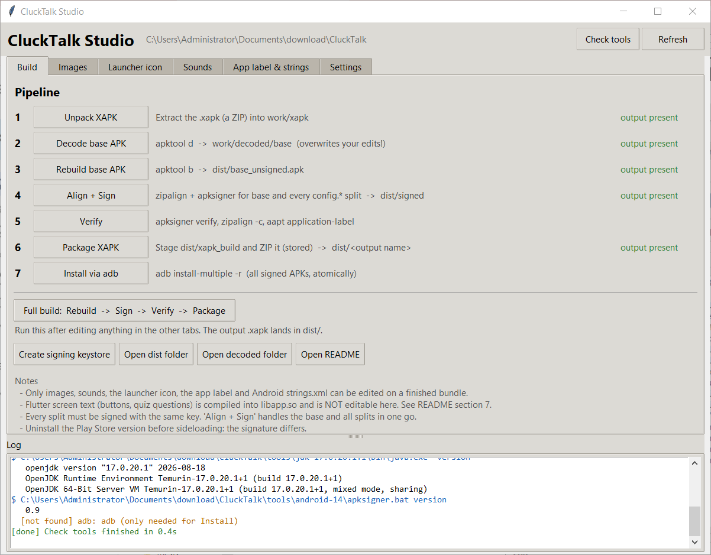
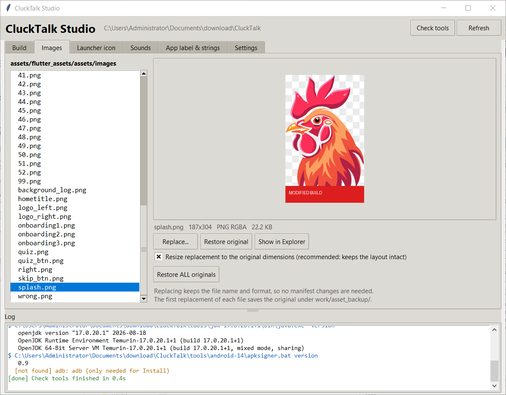
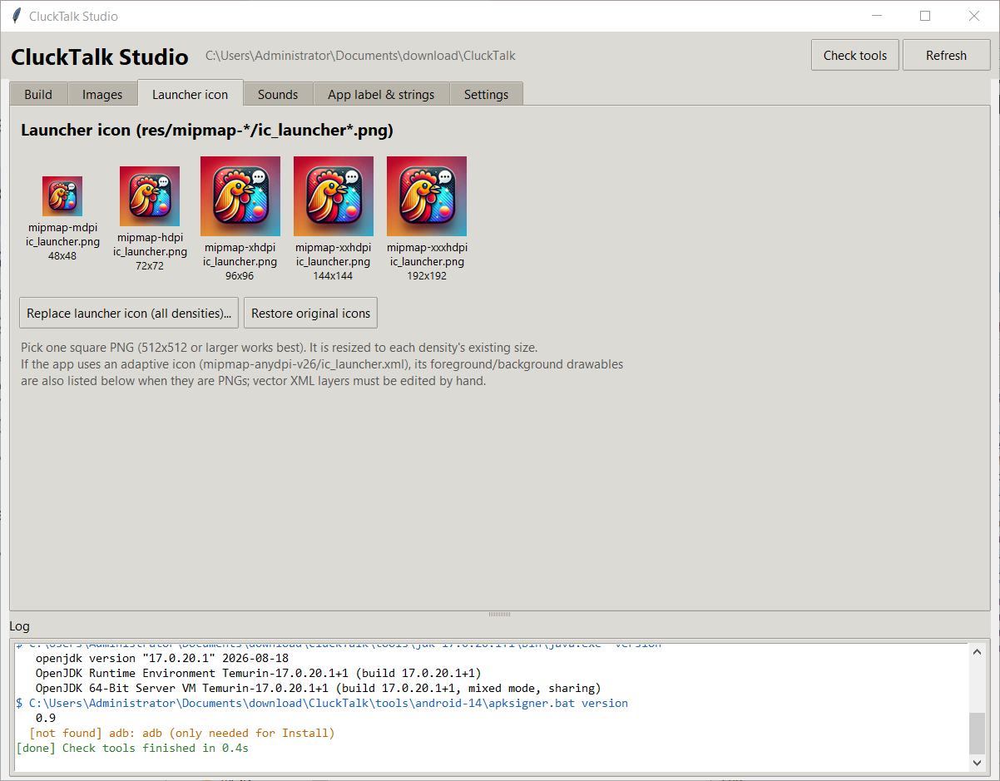
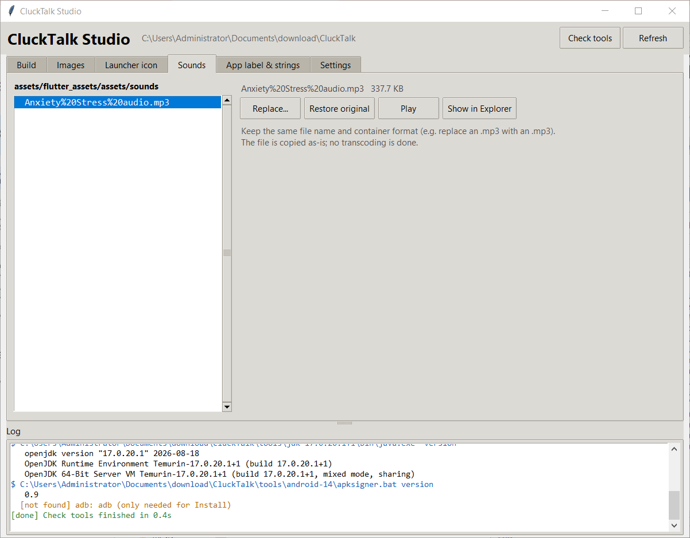
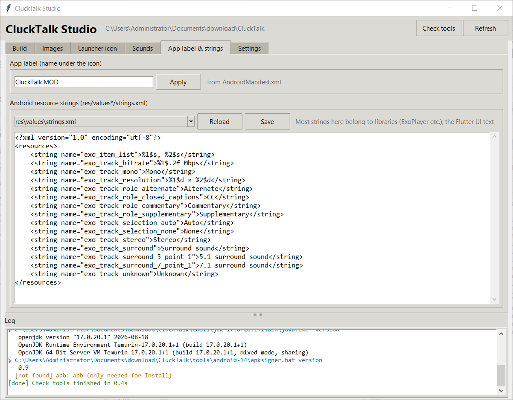
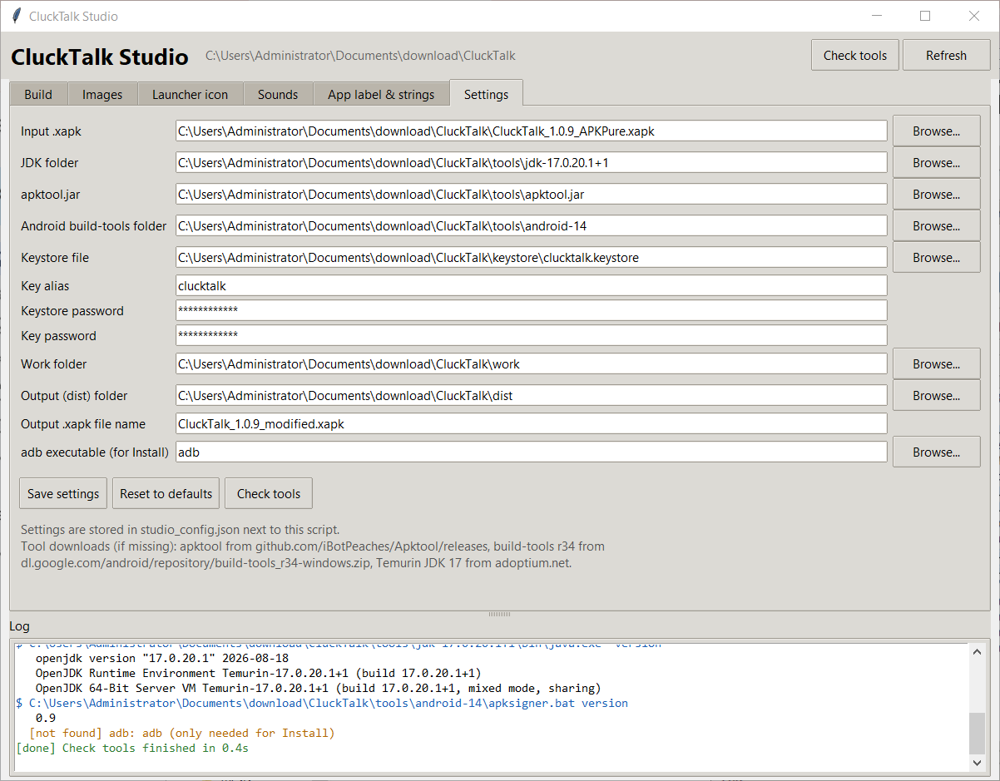

# CluckTalk Studio — User Guide

CluckTalk Studio is a desktop app that turns the manual steps in `README.md` into buttons.
With it you can take the `CluckTalk_1.0.9_APKPure.xapk` bundle apart, swap images, the
launcher icon, sounds and the app name, then rebuild, sign and package an installable
`.xapk` — without typing a single command.

---

## 1. Requirements

| Need | Already on this machine? |
|------|--------------------------|
| Python 3 with tkinter and Pillow | Yes (Python 3.14, Pillow 12) |
| JDK 17 | Yes, `tools/jdk-17.0.20.1+1/` |
| apktool | Yes, `tools/apktool.jar` |
| Android build-tools r34 | Yes, `tools/android-14/` |
| adb (only for the Install button) | No. Download platform-tools from developer.android.com and set the path in Settings. |

If you move the project to another PC, keep the `tools/` and `keystore/` folders next to
the script, or point the Settings tab at wherever they live. On a PC without Pillow run
`python -m pip install pillow` once.

---

## 2. Starting the app

- Double-click **`CluckTalk Studio.bat`**, or
- open a terminal in the `CluckTalk` folder and run `python clucktalk_studio.py`.

Useful command-line flags:

| Command | What it does |
|---------|--------------|
| `python clucktalk_studio.py --check` | Prints which tools were found and which build outputs exist. No window. |

The window has three areas:

1. **Tabs** across the top: Build, Images, Launcher icon, Sounds, App label & strings, Settings.
2. **Log** pane in the lower half. Every command the app runs is printed here with its
   output. Blue lines are commands, green is success, red is failure, orange is a warning.
3. **Status bar** at the bottom. Shows the running task and a progress indicator. While a
   task runs, the action buttons are greyed out.



Two buttons in the header: **Check tools** (verifies all paths and prints tool versions)
and **Refresh** (re-reads the folders if you changed files outside the app).

---

## 3. The workflow in five minutes

The whole loop is:

```
Unpack  →  Decode  →  Edit (tabs)  →  Full build  →  Install
   1          2           3               4             5
```

### Step 1 — Unpack XAPK
Build tab → **1 Unpack XAPK**. Extracts the `.xapk` (it is just a ZIP) into `work/xapk/`.
You get the base APK, four `config.*` split APKs, `manifest.json` and `icon.png`.

### Step 2 — Decode base APK
Build tab → **2 Decode base APK**. Runs apktool and writes an editable tree to
`work/decoded/base/`. Warnings such as "Unresolved resource reference" in the log are normal.

> **Careful:** decoding again later wipes every edit you made and clears the asset
> backups. The app asks you to confirm before doing that.

### Step 3 — Edit
Use the Images, Launcher icon, Sounds and App label & strings tabs (details in section 4).
You can also edit files directly in `work/decoded/base/` with any tool, then press **Refresh**.

### Step 4 — Full build
Build tab → **Full build: Rebuild → Sign → Verify → Package**. This runs:

| Sub-step | Tool | Output |
|----------|------|--------|
| Rebuild | apktool b | `dist/base_unsigned.apk` |
| Align + Sign | zipalign, apksigner | `dist/signed/base.apk` and every `config.*.apk`, all signed with the same key |
| Verify | apksigner verify, zipalign -c, aapt | Log shows "Verifies", scheme v2/v3 true, "Verification succesful", and the app label |
| Package | Python zip (stored) | `dist/CluckTalk_1.0.9_modified.xapk` |

When it finishes the dist folder opens automatically. Expect roughly one to two minutes.
You can also run steps 3 to 6 individually with their own buttons.

### Step 5 — Install
Two options:

- **Button 7 Install via adb** — needs adb and a phone with USB debugging. Installs all
  splits atomically with `adb install-multiple -r`.
- **Copy the `.xapk` to the phone** and open it with SAI (Split APKs Installer) or APKPure.

Uninstall the Play Store version of CluckTalk first. Your build is signed with a different
key, so Android refuses to update over it.

---

## 4. Tab by tab

### Build
- Each numbered row is one pipeline step. The right-hand column says **output present**
  in green once that step has produced its file, or **not yet** in grey.
- **Create signing keystore** makes a self-signed key using the alias and passwords from
  Settings. You only need this once. If a keystore already exists the app warns you,
  because a new key means your earlier builds can no longer be updated in place.
- **Open dist folder**, **Open decoded folder**, **Open README** are shortcuts.


### Images
Left: every file in `assets/flutter_assets/assets/images/` (splash, onboarding pictures,
quiz art, `1.png` … `52.png`). Click one to see it on the right with its size, format and
file size. Transparent areas show over a checkerboard.

- **Replace…** picks a file from disk and writes it over the selected asset, keeping the
  original file name and format. With the checkbox **Resize replacement to the original
  dimensions** on (default), your picture is scaled to the exact original size so the app
  layout does not shift.
- **Restore original** puts the backed-up original back. **Restore ALL originals** does
  it for every image.
- A `*` in front of a name means it has been replaced. Originals are kept in
  `work/asset_backup/`.

Because the file name does not change, you never have to touch `AssetManifest.json`.



### Launcher icon
Shows the home-screen icon at each density (mdpi 48 px up to xxxhdpi 192 px).
**Replace launcher icon (all densities)…** takes one square PNG, ideally 512 px or
larger, and writes a correctly sized copy into every `mipmap-*dpi` folder.
**Restore original icons** undoes it.



### Sounds
Same idea as Images for `assets/flutter_assets/assets/sounds/`. **Play** opens the file in
your default player. Replace an `.mp3` with an `.mp3`; the file is copied as-is.



### App label & strings
- **App label** is the name shown under the icon. Type a new one and press **Apply**. The
  app edits `AndroidManifest.xml` (or the referenced `strings.xml` entry if the label is a
  resource reference).
- **Android resource strings** lets you open any `res/values*/strings.xml` in an editor.
  **Save** checks that the XML still parses before writing, because a broken strings file
  makes the rebuild fail. In this app most of these strings belong to the ExoPlayer library,
  not to the game's own screens.



### Settings
Paths to the input `.xapk`, JDK, apktool, build-tools, keystore, the key alias and
passwords, the work and dist folders, the output file name and the adb executable.
**Save settings** writes `studio_config.json` next to the script. **Reset to defaults**
re-detects everything relative to the project folder.



---

## 5. What you cannot change (important)

CluckTalk is a Flutter app. All of its on-screen text — button labels, quiz questions,
onboarding copy — is compiled into `lib/arm64-v8a/libapp.so`. No apktool-based tool,
including this one, can edit that. What edits cleanly on a finished bundle:

| Editable | Not editable |
|----------|--------------|
| Images and sounds under `assets/` | Flutter UI text |
| Launcher icon | Game logic |
| App name under the icon | Anything in `libapp.so` |
| Android `strings.xml` entries | |

See README section 7 for the binary-patch caveats if you must change Dart text.

---

## 6. Troubleshooting

| Symptom | Fix |
|---------|-----|
| Button greyed out | A task is running. Wait for the status bar to say Finished or FAILED. |
| "No decoded base yet" on the edit tabs | Run Build steps 1 and 2. |
| Rebuild fails with a `brut.androlib` error | A resource or XML edit broke the tree. Undo it, or re-decode and redo your changes. Never delete `apktool.yml`. |
| Sign fails with "Keystore not found" | Press Create signing keystore, or fix the path in Settings. |
| Install fails with `INSTALL_FAILED_UPDATE_INCOMPATIBLE` | The Play Store version is still installed. Uninstall it. |
| Signature mismatch across splits | Run **4 Align + Sign** again; it re-signs the base and all splits with one key. |
| New image does not show in the app | You replaced the wrong file, or added a new file name. Replace existing names only. |
| adb not found | Install Android platform-tools and set the path in Settings. The rest of the app works without it. |
| Something unclear | Read the Log pane. It shows the exact command and the tool's own message. **Copy log** puts it on the clipboard. |

---

## 7. Regenerating the screenshots

```
python clucktalk_studio.py --screenshots docs/screenshots
```

opens the app, walks through every tab and saves one PNG per tab into `docs/screenshots/`.

---

## 8. Files the app creates

```
CluckTalk/
├─ studio_config.json        <- your Settings (only after you press Save settings)
├─ docs/screenshots/         <- images used by this guide
├─ work/
│   ├─ xapk/                 <- unpacked bundle
│   ├─ decoded/base/         <- editable tree (your edits live here)
│   └─ asset_backup/         <- originals of files you replaced
└─ dist/
    ├─ base_unsigned.apk
    ├─ signed/               <- aligned and signed base + splits
    ├─ xapk_build/           <- staging folder
    └─ CluckTalk_1.0.9_modified.xapk   <- the file you install
```

Only modify and redistribute an app when you have the right to do so.
