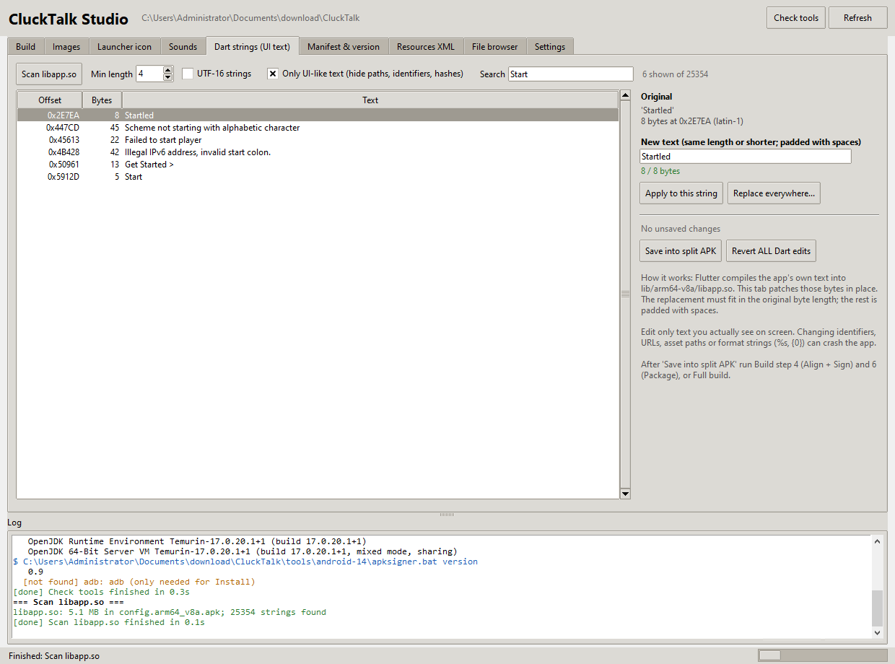
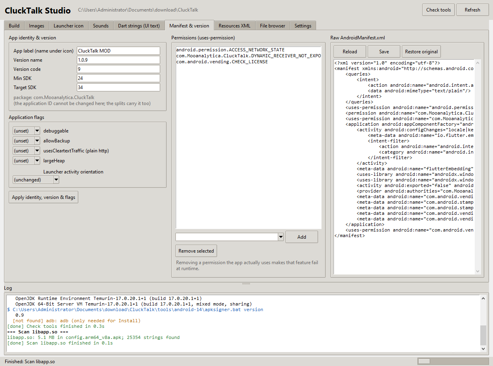
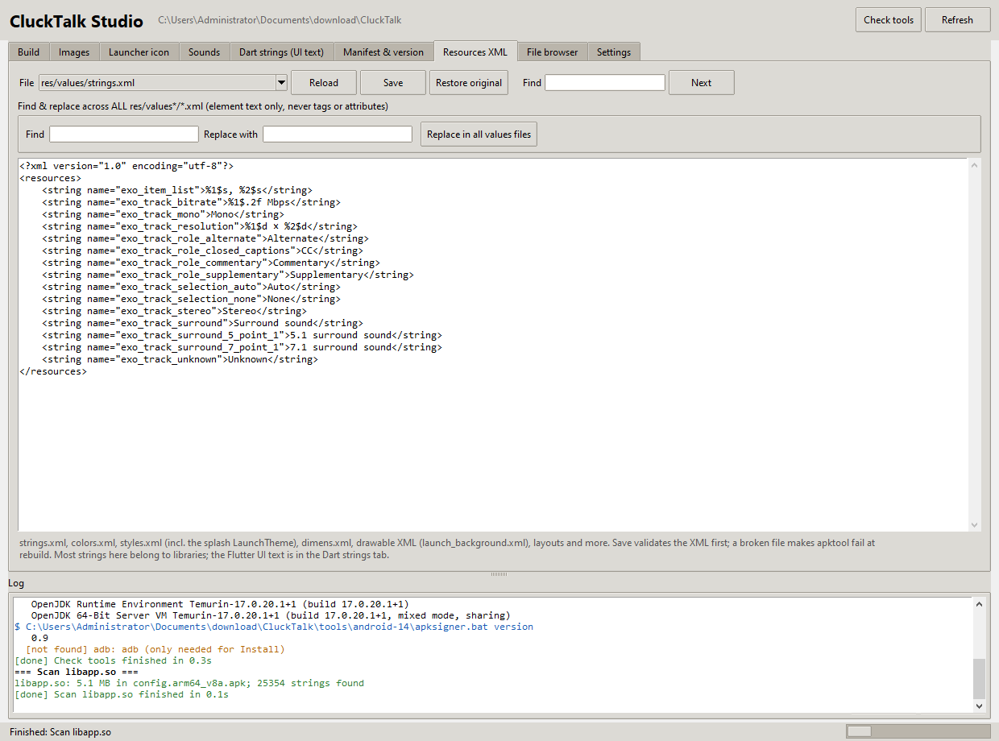
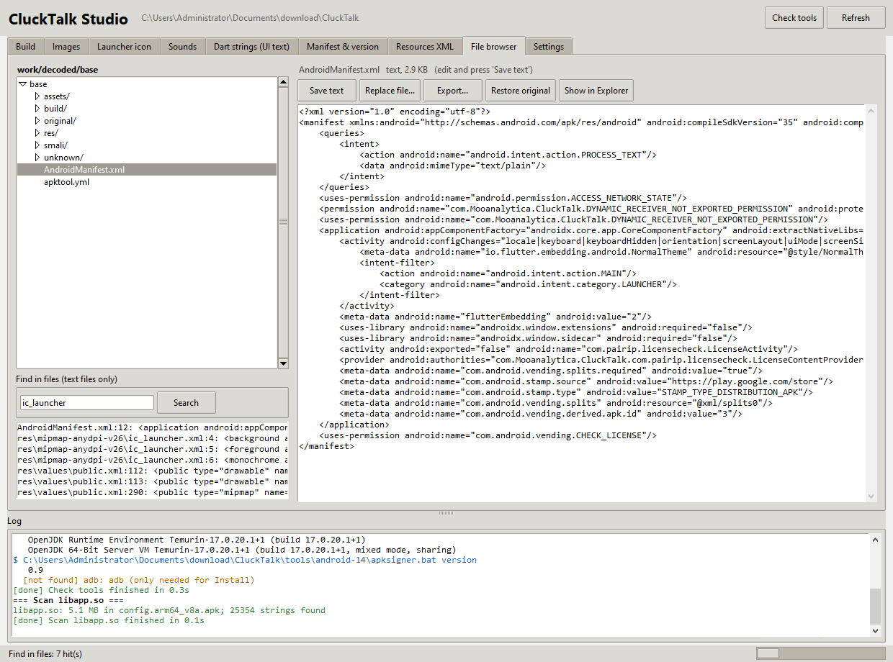
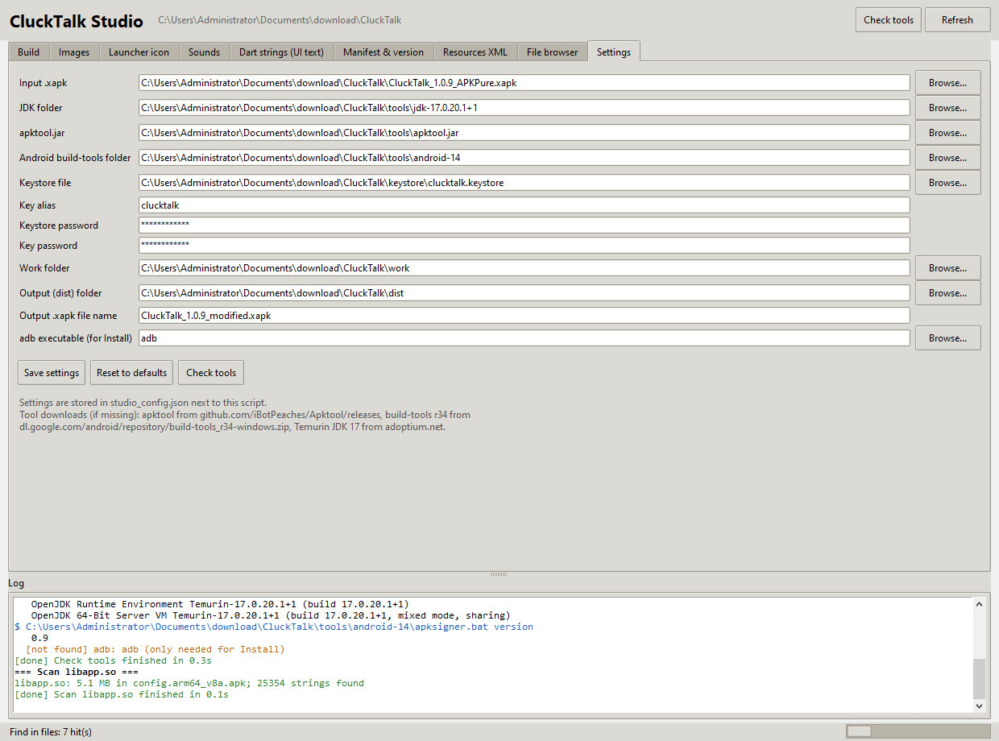

# CluckTalk Studio — User Guide

CluckTalk Studio is a desktop app that turns the manual steps in `README.md` into buttons.
With it you can take the `CluckTalk_1.0.9_APKPure.xapk` bundle apart; swap images, the
launcher icon and sounds; change the on-screen text, app name, version and permissions;
edit any resource file; then rebuild, sign and package an installable `.xapk` — without
typing a single command.

---

## 1. Requirements

| Need | Already on this machine? |
|------|--------------------------|
| Python 3 with tkinter and Pillow | Yes (Python 3.14, Pillow 12) |
| JDK 17 | Yes, `tools/jdk-17.0.20.1+1/` |
| apktool | Yes, `tools/apktool.jar` |
| Android build-tools r34 | Yes, `tools/android-14/` |
| adb (only for the Install button) | No. Download platform-tools from developer.android.com and set the path in Settings. |

If you move the project to another PC, keep the `tools/` and `keystore/` folders next to
the script, or point the Settings tab at wherever they live. On a PC without Pillow run
`python -m pip install pillow` once.

---

## 2. Starting the app

- Double-click **`CluckTalk Studio.bat`**, or
- open a terminal in the `CluckTalk` folder and run `python clucktalk_studio.py`.

| Command | What it does |
|---------|--------------|
| `python clucktalk_studio.py --check` | Prints which tools were found and which build outputs exist. No window. |
| `python clucktalk_studio.py --screenshots docs/screenshots` | Captures every tab to PNG files (used for this guide). |

The window has three areas:

1. **Tabs** across the top: Build, Images, Launcher icon, Sounds, Dart strings, Manifest & version, Resources XML, File browser, Settings.
2. **Log** pane in the lower half. Every command the app runs is printed here with its
   output. Blue lines are commands, green is success, red is failure, orange is a warning.
3. **Status bar** at the bottom. Shows the running task and a progress indicator. While a
   task runs, the action buttons are greyed out.


Two buttons in the header: **Check tools** (verifies all paths and prints tool versions)
and **Refresh** (re-reads the folders if you changed files outside the app).

---

## 3. The workflow in five minutes

```
Unpack  →  Decode  →  Edit (tabs)  →  Full build  →  Install
   1          2           3               4             5
```

### Step 1 — Unpack XAPK
Build tab → **1 Unpack XAPK**. Extracts the `.xapk` (it is just a ZIP) into `work/xapk/`.
You get the base APK, four `config.*` split APKs, `manifest.json` and `icon.png`.
Unpacking again also resets any Dart string edits, because it restores the pristine splits.

### Step 2 — Decode base APK
Build tab → **2 Decode base APK**. Runs apktool and writes an editable tree to
`work/decoded/base/`. Warnings such as "Unresolved resource reference" in the log are normal.

> **Careful:** decoding again later wipes every edit you made in the decoded tree and clears
> the asset backups. The app asks you to confirm before doing that.

### Step 3 — Edit
Use the tabs described in section 4. Everything you change is backed up on first touch, so
every tab has a **Restore original** button.

### Step 4 — Full build
Build tab → **Full build: Rebuild → Sign → Verify → Package**. This runs:

| Sub-step | Tool | Output |
|----------|------|--------|
| Rebuild | apktool b | `dist/base_unsigned.apk` |
| Align + Sign | zipalign, apksigner | `dist/signed/base.apk` and every `config.*.apk`, all signed with the same key |
| Verify | apksigner verify, zipalign -c, aapt | Log shows "Verifies", scheme v2/v3 true, "Verification succesful", and the app label |
| Package | Python zip (stored) | `dist/CluckTalk_1.0.9_modified.xapk` |

When it finishes the dist folder opens automatically. Expect roughly one to two minutes.
You can also run steps 3 to 6 individually with their own buttons.

Dart string edits (section 4.5) live in the arm64 split, not in the decoded base. They are
picked up by **Align + Sign**, so Full build covers them too.

### Step 5 — Install
Two options:

- **Button 7 Install via adb** — needs adb and a phone with USB debugging. Installs all
  splits atomically with `adb install-multiple -r`.
- **Copy the `.xapk` to the phone** and open it with SAI (Split APKs Installer) or APKPure.

Uninstall the Play Store version of CluckTalk first. Your build is signed with a different
key, so Android refuses to update over it.

---

## 4. Tab by tab

### 4.1 Build
- Each numbered row is one pipeline step. The right-hand column says **output present**
  in green once that step has produced its file, or **not yet** in grey.
- **Create signing keystore** makes a self-signed key using the alias and passwords from
  Settings. You only need this once. If a keystore already exists the app warns you,
  because a new key means your earlier builds can no longer be updated in place.
- **Open dist folder**, **Open decoded folder**, **Open README**, **Open user guide** are shortcuts.


### 4.2 Images
Left: the image list. The **Source** box chooses where to look:

| Source | What it lists |
|--------|---------------|
| Flutter assets/images | The app's artwork: splash, onboarding pictures, quiz art, `1.png` … `52.png` |
| Flutter assets (all images) | Every image anywhere under `assets/flutter_assets/` |
| res/ (drawables, mipmaps) | Android resources, including the launcher icon layers |
| Everything in decoded/ | Every image file in the whole decoded tree |

Type in **Filter** to narrow the list. Click an image to see it on the right with its size,
format and file size. Transparent areas show over a checkerboard.


**Replace and restore**

- **Replace…** picks a file from disk and writes it over the selected asset, keeping the
  original file name and format.
- **Paste from clipboard** does the same with an image you copied (from a browser, a
  screenshot, an image editor).
- With **Resize replacement / pasted image to the original dimensions** on (default), your
  picture is scaled to the exact original size so the app layout does not shift.
- **Restore original** puts the backed-up original back. **Export…** saves a copy to disk.
- A `*` in front of a name means the file has been changed. Originals live in `work/asset_backup/`.

**Edit selected image** (applied in place; each click is one step; use Restore original to undo)

| Button | Effect |
|--------|--------|
| Rotate left / right | 90° rotation |
| Flip horizontal / vertical | Mirror |
| Grayscale | Removes colour, keeps transparency |
| Invert | Negative colours, keeps transparency |
| Hue shift… | Rotates all colours around the wheel by the degrees you enter (180 = opposite colours) |
| Brightness… / Contrast… / Saturation… | Percent, 100 = unchanged |
| Blur… | Gaussian blur with the radius you enter |
| Tint… | Overlays a colour you pick at the strength you enter |
| Stamp text… | Draws a caption (text, size, colour, position, optional solid bar behind it) |

**Batch**

- **Export all to folder…** copies every listed image (with sub-folders) to a folder of your
  choice, so you can edit them in Photoshop, GIMP, Figma or anything else.
- **Import from folder (match names)…** brings them back. Files are matched by relative
  path first, then by file name, and resized to the original dimensions if the checkbox is on.
- **Restore ALL originals** undoes everything in the current list.

Because file names never change, you never have to touch `AssetManifest.json`.

### 4.3 Launcher icon
Shows every icon file: the legacy `ic_launcher.png` at each density (mdpi 48 px up to
xxxhdpi 192 px) and the adaptive-icon layers `ic_launcher_foreground.png` and
`ic_launcher_background.png` from `res/drawable`.

- **Replace launcher icon (all densities)…** takes one square PNG, ideally 512 px or
  larger, and writes a correctly sized copy into every legacy density **and** the adaptive
  foreground. On Android 8+ the adaptive icon is what the launcher shows.
- **Replace adaptive foreground only…** / **Replace adaptive background only…** change one layer.
  The foreground should keep transparent margins of about 18 % on each side, because the
  launcher masks it into a circle or rounded square.
- **Restore original icons** undoes all of it.


### 4.4 Sounds
Lists every audio file under `assets/flutter_assets/`, including sub-folders such as
`sounds/Content & Relaxed/`. **Filter** narrows the list.

- **Replace…**, **Restore original**, **Export…**, **Show in Explorer** work per file.
- **Play** opens the file in your default player.
- **Export all to folder…** and **Import from folder (match names)…** work like the image batch tools.
- Replace an `.mp3` with an `.mp3`; the file is copied as-is, nothing is transcoded.


### 4.5 Dart strings (UI text)
This is where the app's own screen text lives: button labels, onboarding copy, quiz
sentences. Flutter compiles it into `lib/arm64-v8a/libapp.so` inside the arm64 split, so
apktool never sees it. This tab patches those bytes directly.



How to use it:

1. Press **Scan libapp.so**. The app extracts the library from `config.arm64_v8a.apk`
   (keeping a pristine copy under `work/native/`) and lists every readable string.
2. Leave **Only UI-like text** on to hide paths, identifiers and hashes, and type in
   **Search** to find the text you saw on screen. Tick **UTF-16 strings** to look for
   two-byte text instead (rare in this app).
3. Click a row. The right side shows the original and a box for the new text with a live
   byte counter.
4. Type the replacement and press **Apply to this string**. Changed rows turn red.
5. **Replace everywhere…** changes a word in every string that contains it, for example
   "Chicken" → "Rooster".
6. Press **Save into split APK**. The patched library is written back into
   `work/xapk/config.arm64_v8a.apk`.
7. Run Build step **4 Align + Sign** and **6 Package**, or simply **Full build**.

The one rule: **the new text must be the same length or shorter** (in bytes). The rest
is padded with spaces, which is invisible on screen in almost all cases. The counter turns
red when you are over the limit.

Things to avoid:

- Do not change text that is not shown on screen: class names, URLs, asset paths such as
  `sounds/…/x.mp3`, or format strings containing `%s`, `{0}` and the like. These can crash the app.
- Do not change the Dart or Flutter version strings.
- If something goes wrong, **Revert ALL Dart edits** restores the pristine split.

### 4.6 Manifest & version
Structured editing of `AndroidManifest.xml` and the build metadata in `apktool.yml`:

- **App label** is the name under the icon.
- **Version name** and **Version code** are what Android and the Play Store compare. Raise
  the version code if you want the mod to install as an "update" over a previous mod build.
- **Min SDK** and **Target SDK** come from `apktool.yml` and are written into the rebuilt APK.
- **Application flags**: debuggable, allowBackup, usesCleartextTraffic, largeHeap. "(unset)"
  removes the attribute, which gives the Android default.
- **Launcher activity orientation** forces portrait, landscape, sensor and so on.
- Press **Apply identity, version & flags** to write all of the above.
- **Permissions**: the list shows every `uses-permission`. Pick one from the drop-down (or
  type any name) and **Add**, or select a row and **Remove selected**. Removing a permission
  the app really uses makes that feature fail at runtime.
- **Raw AndroidManifest.xml**: a plain editor for anything else. **Save** validates the XML
  first. **Restore original** brings back the untouched manifest.

The application ID (`package=`) cannot be changed here because the split APKs carry it as
well; renaming it would need all four splits rebuilt.



### 4.7 Resources XML
A text editor for every XML file under `res/`: `values/strings.xml`, `colors.xml`,
`styles.xml` (which holds the splash `LaunchTheme`), `dimens.xml`, `drawable/launch_background.xml`,
layouts and more.

- Pick a file in the **File** box. Files with a `*` have been changed.
- **Find** + **Next** jumps through the text.
- **Save** validates the XML before writing, because a broken file makes apktool fail at rebuild.
- **Restore original** undoes your changes to that file.
- **Find & replace across ALL res/values*/*.xml** changes element text in every values file
  at once, never tags or attribute names.

Most strings here belong to libraries (ExoPlayer and friends). The Flutter UI text is in the
Dart strings tab.



### 4.8 File browser
The safety net for anything the other tabs do not cover. The tree on the left is
`work/decoded/base/`. Click a file:

- Text files (XML, YAML, JSON, smali, properties, …) open in the editor. **Save text** writes
  them back (XML is validated first).
- Images show a preview and a hint to edit them in the Images tab.
- Binary files show their size; use **Replace file…** or **Export…**.
- **Restore original** and **Show in Explorer** work on every file.

**Find in files** searches every text file in the tree for a word. Click a hit to open that
file at that line.



### 4.9 Settings
Paths to the input `.xapk`, JDK, apktool, build-tools, keystore, the key alias and
passwords, the work and dist folders, the output file name and the adb executable.
**Save settings** writes `studio_config.json` next to the script. **Reset to defaults**
re-detects everything relative to the project folder.



---

## 5. What you can and cannot change

| Editable | How | Limits |
|----------|-----|--------|
| Images and sounds under `assets/` | Images / Sounds tabs | Same file name; dimensions auto-matched |
| Launcher icon (legacy + adaptive) | Launcher icon tab | |
| App name under the icon | Manifest & version tab | |
| Version name / code, min / target SDK | Manifest & version tab | |
| Permissions, application flags, orientation | Manifest & version tab | |
| Android `strings.xml`, colours, styles, drawables | Resources XML tab | |
| On-screen Flutter text | Dart strings tab | **Same length or shorter**; only text you actually see |
| Any other text or binary file | File browser tab | Smali edits need Android knowledge |

Not possible with this tool: making Flutter text longer, changing game logic, changing the
application ID, or adding brand-new asset files (replace an existing one instead).

---

## 6. Troubleshooting

| Symptom | Fix |
|---------|-----|
| Button greyed out | A task is running. Wait for the status bar to say Finished or FAILED. |
| "No decoded base yet" on the edit tabs | Run Build steps 1 and 2. |
| Dart strings tab: "No native split" | Run Build step 1 (Unpack) first. |
| Dart strings: counter is red | The new text is longer than the original. Shorten it or abbreviate. |
| App crashes on start after a Dart edit | You changed an identifier, path or format string. Press Revert ALL Dart edits, re-sign, and change only visible text. |
| Rebuild fails with a `brut.androlib` error | A resource or XML edit broke the tree. Use Restore original on the file you last touched, or re-decode and redo your changes. Never delete `apktool.yml`. |
| Sign fails with "Keystore not found" | Press Create signing keystore, or fix the path in Settings. |
| Install fails with `INSTALL_FAILED_UPDATE_INCOMPATIBLE` | The Play Store version is still installed. Uninstall it. |
| Signature mismatch across splits | Run **4 Align + Sign** again; it re-signs the base and all splits with one key. |
| New image does not show in the app | You replaced the wrong file, or added a new file name. Replace existing names only. |
| adb not found | Install Android platform-tools and set the path in Settings. The rest of the app works without it. |
| Something unclear | Read the Log pane. It shows the exact command and the tool's own message. **Copy log** puts it on the clipboard. |

---

## 7. Regenerating the screenshots

```
python clucktalk_studio.py --screenshots docs/screenshots
```

opens the app, walks through every tab and saves one PNG per tab into `docs/screenshots/`.

---

## 8. Files the app creates

```
CluckTalk/
├─ studio_config.json        <- your Settings (only after you press Save settings)
├─ docs/screenshots/         <- images used by this guide
├─ work/
│   ├─ xapk/                 <- unpacked bundle (the arm64 split is rewritten by Dart string edits)
│   ├─ decoded/base/         <- editable tree (your edits live here)
│   ├─ asset_backup/         <- originals of files you changed in the decoded tree
│   └─ native/               <- pristine copies of the arm64 split and libapp.so, plus the patched libapp.so
└─ dist/
    ├─ base_unsigned.apk
    ├─ signed/               <- aligned and signed base + splits
    ├─ xapk_build/           <- staging folder
    └─ CluckTalk_1.0.9_modified.xapk   <- the file you install
```

Only modify and redistribute an app when you have the right to do so.
